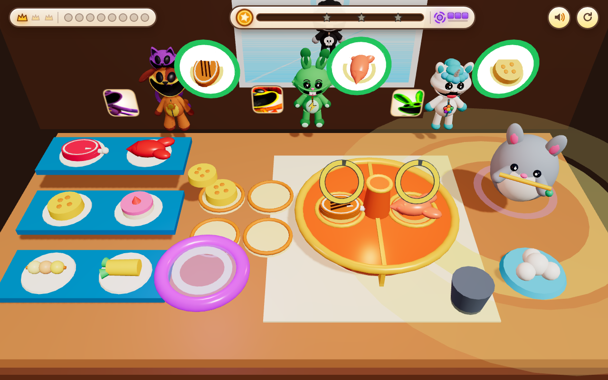

# 🍲🐾❄️ Critter Cozy Bunker 3D: Pocket Vacuum & Snow Hotpot!

🔗 **Play Live**: [https://kunruiw1991.github.io/critters-bunker3d/](https://kunruiw1991.github.io/critters-bunker3d/)

## ✨ Game Highlights
Inspired by hilarious web-novel cozy bunker & dimensional pocket tropes (*"空间异能零元购 + 零下70度安全屋吃铜火锅 + 花花骑乐乐 + 吹笛子的大龙猫"*):
- **🌀 1:1 3D Purple Dimensional Vortex Vacuum (`空间异能漩涡`)**: Drag the glowing purple vortex ring across the 3D Supermarket Toy Shelf (or tap any food item) to suck **Tomahawk Ribeye Steaks**, **Giant Red Lobsters**, **Golden Swiss Cheese Wheels**, **Strawberry Shortcakes**, **Bouncy Fishball Skewers**, and **Sweet Corn Cobs** along a `1/120s` substepped 3D spiral trajectory into your cozy bunker tray!
- **🍲 Bubbling 3D Copper Mandarin-Duck Hotpot (`鸳鸯铜火锅`)**: Drop supplies into the twin Spicy Red & Savory Gold boiling broths (`RingGeometry` vertex-displaced waves) and serve steaming delicacies to hungry Smiling Critters!
- **🐱🐶 CatNap Riding DogDay (`花花骑乐乐`) & 🐹 Flute-Playing Giant Chinchilla (`吹笛子的大龙猫`)**: Features the authentic `v11` 3D plush CatNap mounted on `v11` DogDay's back, plus a fluffy 3D Giant Chinchilla playing a golden bamboo flute that sends out musical shockwaves to speed-boost cooking and cheer up guests!
- **⛄ Frosted `-70°C` Window Snowball Defense**: Bonk peeking `Baba Chops` snow-bandits outside the frosted window into hilarious 3D Snowmen with carrot noses!
- **🔇 100% Zero-Text & Zero-Voiceover Pure Visual UI**: Designed for 5-year-old players with pure 3D visual cues, custom procedural WebAudio ASMR, and a 5-Critter Top-3 Podium progression system.
